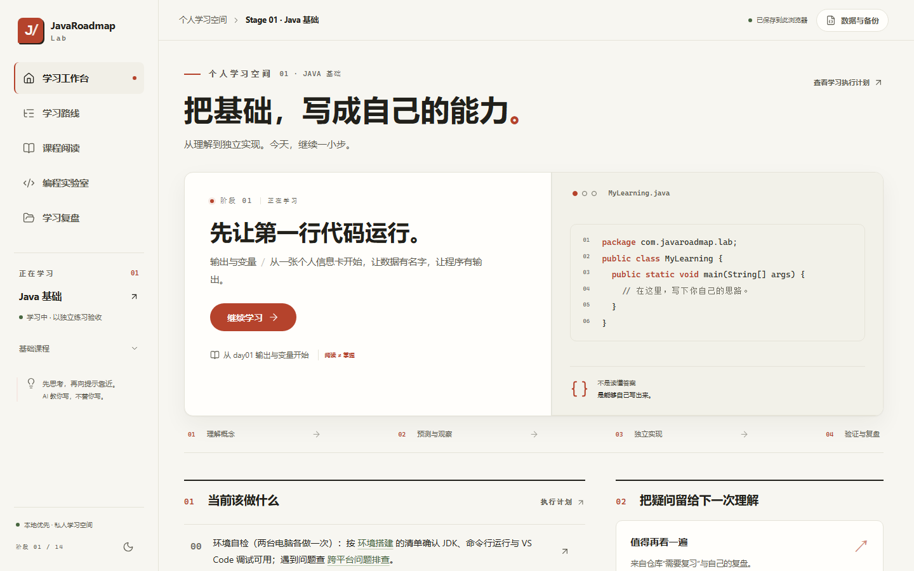
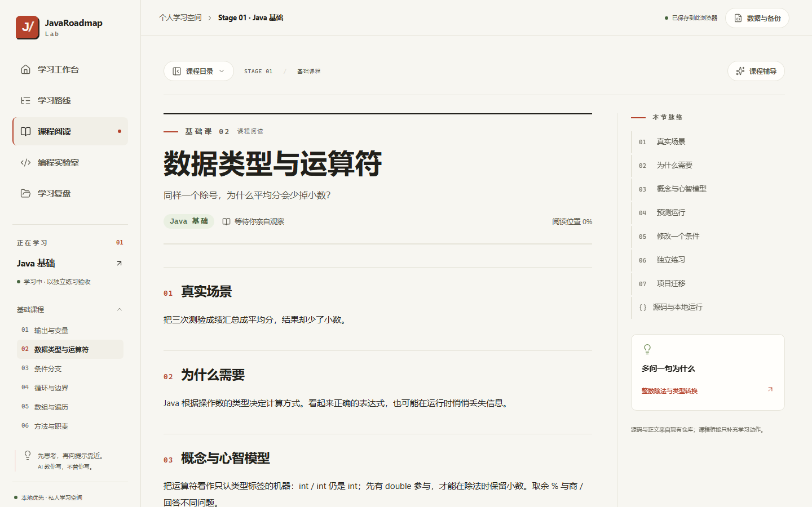
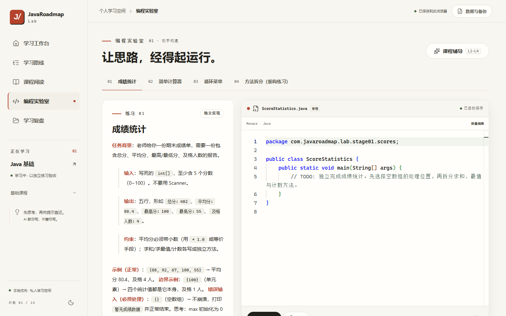

# JavaRoadmap Lab

**面向独立编程能力培养的 Java 后端与 AI 应用开发学习平台。**

JavaRoadmap Lab 把一条 14 Stage 的学习路线做成了可以动手验证的学习系统：仓库维护课程教程、Java 源码与练习资产；[JavaRoadmap Lab 网站](https://hrry1n.github.io/Java-AI-Learning-Roadmap/)提供课程阅读、输出预测、独立编程与学习复盘；本地 JDK 负责真实编译运行。三者围绕同一个原则——**看懂教程不等于会写代码，运行参考实现也不等于掌握**。

[在线学习网站](https://hrry1n.github.io/Java-AI-Learning-Roadmap/) · [快速开始](#快速开始) · [学习工作流](#学习工作流) · [文档索引](#路线图与相关文档)

---

## 项目介绍

- **它是什么**：一个本地优先的学习平台，由三部分组成——仓库中的课程资产（教程、概念深化课、练习、参考实现）、可交互的学习网站（JavaRoadmap Lab）、以及一组本地验证 CLI（编译、运行、比对、生成实测记录）。
- **它解决什么问题**：自学编程最常见的失败方式是"教程看懂了，代码写不出来"。这里每个概念都要求先预测输出、再修改条件、再在 TODO 骨架上独立实现核心逻辑，最后用真实 JDK 编译运行验证——把"以为自己会"变成可检验的状态。
- **为什么强调独立编程**：课程辅导只提供 L1–L4 分级提示，不直接给答案；完整参考实现需要明确确认后才加载，查看行为会计入学习记录；预测题必须先写下自己的判断再核对。网站不自动修改学习状态，也不把 AI 生成代码或参考运行算作个人完成。
- **技术主线**：以 **Java 后端**为主线（OOP → Java Core → MySQL → Spring Boot / MyBatis → Redis → 项目 A 传统后端系统），**Python / LLM / RAG / Agent** 作为第二技术栈在后续 Stage 展开（项目 B：Java 智能知识库平台）。
- **适用人群**：正在自学 Java 后端、希望用可验证方式建立独立编程能力的学习者；仓库维护者本人按此路线执行，也欢迎按同样方式参考或 fork 使用。

## 项目预览

学习工作台首页——从当前任务进入课程、预测与练习：



| 课程阅读 | 编程实验室 |
| --- | --- |
|  |  |

截图来自 V1.1 视觉重构验收记录，当前内容以网站为准（[更多对比图](docs/javaroadmap_lab/visual-renaissance.md)）。

## 主要功能

| 功能 | 说明 |
| --- | --- |
| 14 Stage 学习路线 | 完整知识地图驱动站点导航，路线信息与已有材料同时呈现 |
| 课程阅读 | 19 节正式课程（Stage 01×13 + Stage 02×6），支持单文件与多文件 Java 示例展示 |
| 输出预测 | 12 道预测题按确定答案本地判定，先写判断再核对语义 |
| 条件修改 | 6 道开放修改题，在自己的副本上改条件、预测差异、运行验证 |
| 独立编程实验室 | 5 道练习从 TODO 骨架起步，核心逻辑由学习者完成 |
| L1–L4 渐进提示 | 理解问题 → 相关知识 → 结构思路 → 调试线索，逐级解锁并计入复盘 |
| 草稿自动保存 | 代码草稿、阅读位置、提示等级、预测作答实时存入浏览器 IndexedDB |
| 本地 Java 验证 | `verify-practice` CLI 在本机编译运行学习者源码，精确比对后导入实测记录 |
| 学习复盘 | 区分阅读、尝试、提示使用、参考查看与所列用例结果，不生成虚假完成度 |
| 备份与迁移 | 一键导出完整备份 JSON，跨浏览器 / 跨设备（Windows / macOS）合并或替换恢复 |

**能力边界（当前版本）**：网站不提供浏览器内 Java JVM，也没有启用真实 AI 在线辅导、云同步和在线 Java 沙箱。课程辅导是内置固定引导；Java 一律在学习者本地的可信 JDK 中运行。

## 当前课程建设进度

平台内容建设进度（与个人学习进度分开，见下）：

| Stage | 主题 | 内容状态 |
| --- | --- | --- |
| Stage 01 | Java 基础：day01–day06 + 概念深化 deep01–deep07 | 已发布，共 13 课 |
| Stage 02 | Java OOP：第一批 6 课（类与对象 / 构造与 this / 封装 3 节基础课 + 引用状态 / 对象构造 / 封装动因 3 节深化课） | 第一批已发布，阶段标注"持续建设" |
| Stage 02 | 继承与多态深化课、逐日示例与综合练习（第二批） | 待建设，网站未发布；仓库已有相关材料 |
| Stage 03 | Java Core | 仓库已有课程、练习与参考示例，网站课程尚未发布 |
| Stage 08、10–12 | 工程能力、Python、LLM 应用与 RAG | 仓库已有教程或示例，网站课程尚未发布 |
| Stage 04–07、09、13–14 | Java 进阶、数据库、后端框架、Agent 与项目 | 路线规划，尚未创建对应阶段课程 |

- **规划了 14 个阶段**不等于**完成了 14 个阶段**；尚未建立教材目录的阶段保留在路线图中，不用空目录表示进度。
- **平台内容建设进度**（本表）与**学习者个人学习进度**是两回事：个人进度只按 [真实学习进度](真实学习进度.md) 中自己的代码、验证结果和复盘记录状态，当前为 Stage 01 验收阶段。

## 快速开始

### 方式 A：直接在线学习

打开 [https://hrry1n.github.io/Java-AI-Learning-Roadmap/](https://hrry1n.github.io/Java-AI-Learning-Roadmap/) 即可，无需安装 Node.js 或 JDK。阅读、预测、草稿与备份都在浏览器内完成；只有运行自己的 Java 代码时才需要本地 JDK。

### 方式 B：本地运行网站

环境要求：**Node.js 22.12 或更新版本**（npm 按锁文件安装，无需任何模型密钥或账号）；本地运行自己的 Java 另需完整 JDK。

```bash
git clone https://github.com/HrrY1n/Java-AI-Learning-Roadmap.git
cd Java-AI-Learning-Roadmap/web
npm ci
npm run dev
```

浏览器打开 [http://127.0.0.1:5173](http://127.0.0.1:5173)。开发服务仅监听本机；端口占用会明确失败，可改用 `npm run dev -- --port 5174`（换端口会更换浏览器存储来源，先导出学习备份）。更多本地使用细节见 [web/README.md](web/README.md)。

## Java 每日课程目录怎么读

每天的课程目录是包含 `com/` 的源码根目录，内部路径与 `package` 对应。以 Stage 02 第一天为例：

```text
day01_class_object/
└─ com/javaroadmap/stage02/day01classobject/
   ├─ App.java
   └─ Student.java
```

同一天相互依赖的类放在同一个包中并一起编译；不同课程使用不同包名。IntelliJ IDEA 中将包含 `com/` 的课程目录设为 Sources Root；命令行编译与运行示例见 [环境搭建](docs/环境搭建.md)。

## 学习工作流

```text
阅读概念 → 预测输出 → 修改代码 → 独立练习 → 本地 JDK 验证 → 学习复盘
```

1. **阅读概念**：课程页从真实开发场景进入，先建立心智模型再看最小代码；多文件课程按包结构展示全部依赖类。
2. **预测输出**：对每段示例先写下自己的预期，网站按确定答案判定，不一致时回去重走执行顺序。
3. **修改代码**：条件修改题要求在自己复制的源码上改动并预测差异，不提供自动判分。
4. **独立练习**：实验室练习只有 TODO 骨架与用例契约；卡住时逐级打开 L1–L4 提示，解锁不把答案填进编辑器。
5. **本地 JDK 验证**：下载源码或使用 `verify-practice` CLI，在本机编译运行并精确比对输出，生成实测记录后导入网站。
6. **学习复盘**：复盘页分层呈现阅读、尝试、提示、参考查看与实测结果，供回顾与复习。

**诚实性约定**：AI 生成代码、运行或改进参考实现，都不等于学习者已经掌握；学习状态只由 [真实学习进度](真实学习进度.md) 中的证据决定，网站操作不会自动修改它。

## 技术栈与项目结构

| 技术 | 用途 |
| --- | --- |
| React 19 + TypeScript | 站点前端（严格模式类型检查） |
| Vite | 开发与生产构建，`base: './'` 支持任意静态子路径部署 |
| Monaco Editor | 桌面端 Java 代码编辑器（语法高亮，无语言服务器 / 编译器） |
| react-markdown + highlight.js | 课程 Markdown 与代码渲染 |
| IndexedDB | 学习记录、草稿与主题的本地存储（schemaVersion 校验的备份格式） |
| GitHub Actions | 三平台 CI 矩阵 + Pages 构建、部署与线上冒烟 |

```text
web/               # JavaRoadmap Lab 网站（React + Vite，本目录独立构建部署）
web/content/       # 课程结构化元数据（构建期生成 catalog，不提交生成物）
stages/            # 课程教程、概念深化课、练习与参考实现（Java 源码唯一来源）
scripts/           # Java 课程回归、练习验证 CLI、内容与链接检查
docs/              # 环境搭建、跨平台排查、教学协作与 Lab 交付文档
学习执行计划.md     # 唯一回答"现在该学什么"的入口（CURRENT / NEXT / PARALLEL / LATER）
真实学习进度.md     # 个人学习状态，只按证据记录
统一学习路线.md     # 14 Stage 完整知识地图
```

课程内容的唯一来源是仓库里的 Markdown 与 Java 源文件；网站课程数据在构建期从这些源文件生成，不手工维护第二份副本。

## 开发、构建与测试

以下命令在 `web/` 目录运行：

| 命令 | 作用 |
| --- | --- |
| `npm run dev` | 生成课程数据并启动本地开发服务（127.0.0.1:5173） |
| `npm run typecheck` | 生成课程数据并执行严格 TypeScript 检查 |
| `npm test` | 单元测试 + 内容架构 / 练习编译 / 预测 JVM 语义等 Node 测试 |
| `npm run test:e2e` | Playwright 浏览器测试（首次需 `npx playwright install chromium`） |
| `npm run build` | 类型检查 + 生产构建，输出 `dist/` |
| `npm run check:build` | 校验构建产物的入口资源、Monaco worker 与懒加载参考文件 |
| `npm run preview` | 本地生产预览（127.0.0.1:4173，请通过 HTTP 访问而非双击 index.html） |

以下命令在仓库根运行：

| 命令 | 作用 |
| --- | --- |
| `bash scripts/verify_java.sh` 或 `powershell -ExecutionPolicy Bypass -File scripts\verify_java.ps1` | Java 课程回归：按 `scripts/verify_manifest.tsv` 逐课编译、运行并校验输出（当前 59 项） |
| `npm run verify:practice -- --exercise <id> --source <源码文件> --expect-file <预期输出文件>`（在 `web/`） | 学习者练习的单次精确验证；先运行 `npm run content`，替换占位符并按 [指南](docs/javaroadmap_lab/local-java.md) 生成、导入证据 |
| `python scripts/check_links.py` | 检查仓库 Markdown 相对链接 |

网站 CI 在 Ubuntu / Windows / macOS（Node 24 + Temurin JDK 25）上运行类型检查、测试、生产构建与核心浏览器测试；Java 课程回归在 Windows / macOS × JDK 21 / 25 上运行。push 到 main 后由独立 Pages 工作流构建、部署并执行线上冒烟。完整配置见 [.github/workflows/](.github/workflows/)。

## 数据与隐私

- 个人学习记录（草稿、预测、提示、实测记录、主题）只存储在**当前浏览器当前站点来源**的 IndexedDB 中。
- 不随 Git 提交同步，不自动同步 GitHub，也不会跨浏览器或跨设备自动同步。
- 定期使用顶栏"数据与备份 → 导出完整备份"导出 JSON 备份；在另一台设备导入时可选"合并"（保留同项较新版本）或"替换"（替换前会自动下载当前记录备份）。损坏或版本不兼容的备份会被拒绝导入。
- 清理站点数据、退出隐私模式或更换端口都可能使当前记录不可见，重要节点请先备份。
- 个人 Java 练习只应在本机可信 JDK 环境中运行；验证 CLI 在本地以用户权限执行，不作为任何线上服务的执行接口。

数据模型与迁移细则见 [docs/javaroadmap_lab/data-and-services.md](docs/javaroadmap_lab/data-and-services.md)。

## 路线图与相关文档

| 文档 | 内容 |
| --- | --- |
| [统一学习路线](统一学习路线.md) | 14 Stage 知识地图、双项目与框架取舍 |
| [学习执行计划](学习执行计划.md) | 当前执行入口（CURRENT / NEXT / PARALLEL / LATER） |
| [真实学习进度](真实学习进度.md) | 个人学习状态与证据记录 |
| [求职能力矩阵](求职能力矩阵.md) | Java 后端与 AI 应用能力缺口参考 |
| [环境搭建](docs/环境搭建.md) | Windows / macOS（Apple Silicon）JDK 与 VS Code 配置 |
| [跨平台问题排查](docs/跨平台问题排查.md) | 双平台常见环境问题 |
| [教学协作细则](docs/教学协作细则.md) | AI 在概念讲解 / 练习 / Debug / Review 中的协作模式 |
| [Lab 交付文档](docs/javaroadmap_lab/README.md) | 设计、架构、内容、数据与验收文档索引 |
| [新增课程指南](docs/javaroadmap_lab/new-lesson-guide.md) | 向网站接入新 Stage 课程的脚手架与契约 |
| [web/README.md](web/README.md) | 网站本地使用、备份迁移与静态部署说明 |
| [AGENTS.md](AGENTS.md) | 仓库协作规则、教学模型与验证入口 |

下一批课程建设方向：Stage 02 第二批（继承与多态深化、逐日示例与综合练习，含 S02A4 / S02B1 / S02B3 转正）。路线层的长期取舍见 [统一学习路线](统一学习路线.md) 与 [学习执行计划](学习执行计划.md)。
