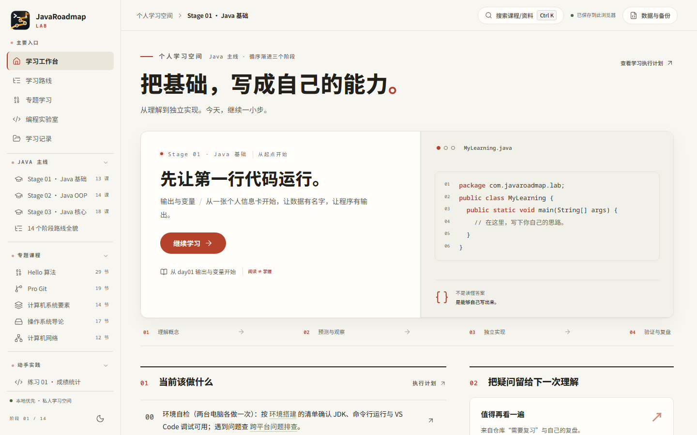
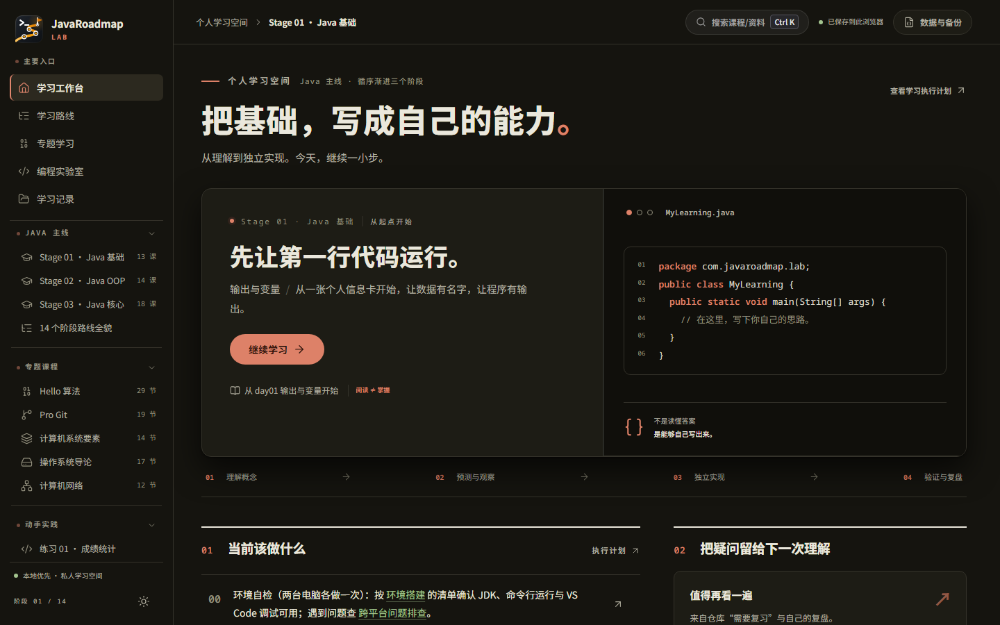
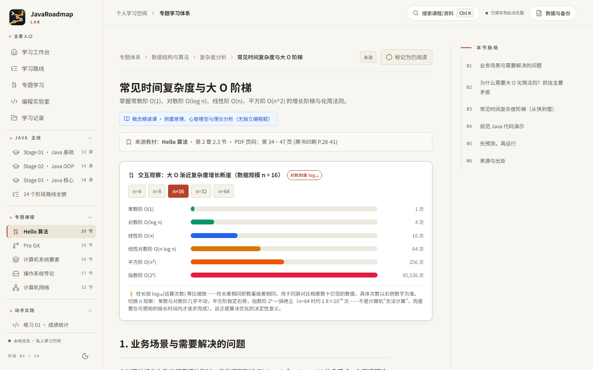

# JavaRoadmap Lab

**面向独立编程能力培养的 Java 后端与 AI 应用开发学习平台。**

自学编程最常见的困境是"教程看懂了，代码却写不出来"。JavaRoadmap Lab 把一条 14 Stage 的学习路线做成可动手验证的学习系统：在网站上读课程、预测输出、修改条件、独立实现，再用本地 JDK 真实编译运行——每一步掌握程度都有据可查。

> **看懂教程不等于会写代码，运行参考实现也不等于掌握。**

[在线学习网站](https://hrry1n.github.io/Java-AI-Learning-Roadmap/) · [快速开始](#快速开始) · [核心特性](#核心特性) · [文档索引](#核心文档索引)

---

## 核心特性

1. **14 阶段系统化知识图谱**：一条完整路线从 Java 基础、OOP 与核心 API 延伸到 MySQL / Spring Boot / Redis / 后端项目，再到 Python / LLM / RAG / Agent 第二技术栈与 Java 智能知识库项目；配套已发布 45 节主线课程、5 个专题共 91 节（算法、Git、CS:APP、OSTEP、计算机网络）及原著延伸阅读。
2. **强制动手的验证闭环**：每节课从真实开发问题与最小代码出发，经过输出预测、条件修改、TODO 骨架独立实现，最后由本机 JDK 编译运行并比对输出，把"以为自己会"变成可检验的结果。
3. **渐进式提示与防偷看机制**：预测题先写判断再核对；练习只给骨架与用例契约，卡住时按 L1–L4 逐级获取提示；完整参考实现需明确确认后才加载，查看行为计入学习记录，不直接给答案。
4. **纯本地优先与隐私安全**：学习记录只存于当前浏览器的 IndexedDB，免登录、不自动云同步，支持带校验的完整 JSON 导入导出与跨设备迁移。

## 界面预览

<p align="center">
  
</p>

<p align="center"><sub>桌面端 · 学习工作台</sub></p>

<p align="center">
  
</p>

<p align="center"><sub>桌面端 · 深色主题</sub></p>

<p align="center">
  
</p>

<p align="center"><sub>专题课程 · 阅读页</sub></p>

## 快速开始

### 方式 A：在线体验（无需配置）

打开 [JavaRoadmap Lab](https://hrry1n.github.io/Java-AI-Learning-Roadmap/) 即可开始，桌面与移动浏览器均可用，免注册登录；学习数据保存在当前浏览器本地。

### 方式 B：本地启动

需要 **Node.js 22.12+**（按锁文件安装，无需账号或模型密钥）；运行自己的 Java 另需完整 JDK。

```bash
git clone https://github.com/HrrY1n/Java-AI-Learning-Roadmap.git
cd Java-AI-Learning-Roadmap/web
npm ci
npm run dev
```

浏览器打开 [http://127.0.0.1:5173](http://127.0.0.1:5173)。开发、构建、测试与部署命令见 [web/README.md](web/README.md)。

> 课程目录按 `com/` 包结构组织，每个课程目录即独立源码根；命令行与 IDE 配置见 [环境搭建](docs/环境搭建.md)。

## 核心学习闭环

```text
概念阅读 → 输出预测 → 条件修改 → 独立练习 → 本地验证 → 学习复盘
```

每节课从真实开发场景进入，先建立心智模型再看最小代码；写下自己的输出判断后核对语义，再在副本上改一个条件、预测差异并运行观察。独立练习只留 TODO 骨架与用例契约，卡住时逐级打开 L1–L4 提示，参考实现不会自动填入编辑器。最后用本机 JDK 编译运行、精确比对输出并导入实测记录，复盘页分层呈现阅读、尝试、提示与实测证据。每一步只记录你自己产生的证据：网站操作不自动判定掌握，运行参考实现或 AI 生成代码不计入个人能力证据；学习状态以学习者私有维护的真实进度记录为准，该文档不随公开仓库发布。

## 核心文档索引

- **学习路线与进度**：完整路线、执行计划、真实进度与能力矩阵由学习者私有维护，不随公开仓库发布；公开课程内容与 14 Stage 结构见[课程目录](stages/README.md)与[在线网站](https://hrry1n.github.io/Java-AI-Learning-Roadmap/)。
- **课程入口**：[课程总览](stages/README.md) · [Stage 01 Java 基础](stages/stage01_java_basics/README.md) · [Stage 02 面向对象基础](stages/stage02_java_oop/README.md)
- **环境与运行**：[环境搭建](docs/环境搭建.md) · [Java 课程运行说明](docs/Java课程运行说明.md) · [跨平台问题排查](docs/跨平台问题排查.md)
- **验证 CLI 与数据**：[验证脚本](scripts/README.md) · [本地 Java 验证指南](docs/javaroadmap_lab/local-java.md) · [数据模型与迁移](docs/javaroadmap_lab/data-and-services.md)
- **贡献与开发**：[web/README.md](web/README.md) · [Lab 交付文档目录](docs/javaroadmap_lab/README.md) · [内容架构与脚手架指南](docs/javaroadmap_lab/new-lesson-guide.md) · [CI 工作流](.github/workflows/) · [教学协作细则](docs/教学协作细则.md) · [AGENTS.md](AGENTS.md) · [V1.4 设计选型报告](docs/javaroadmap_lab/v1.4_design_proposals.md)
