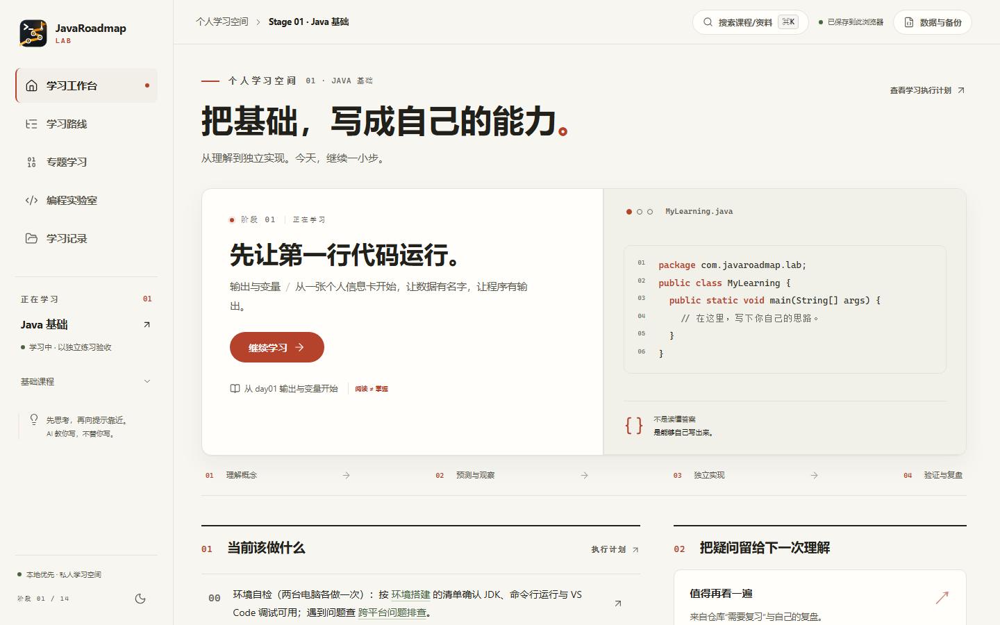
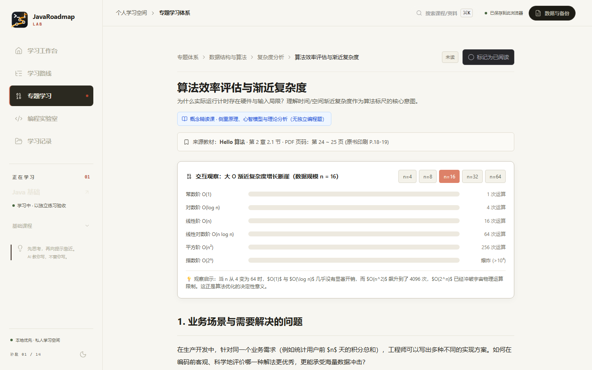
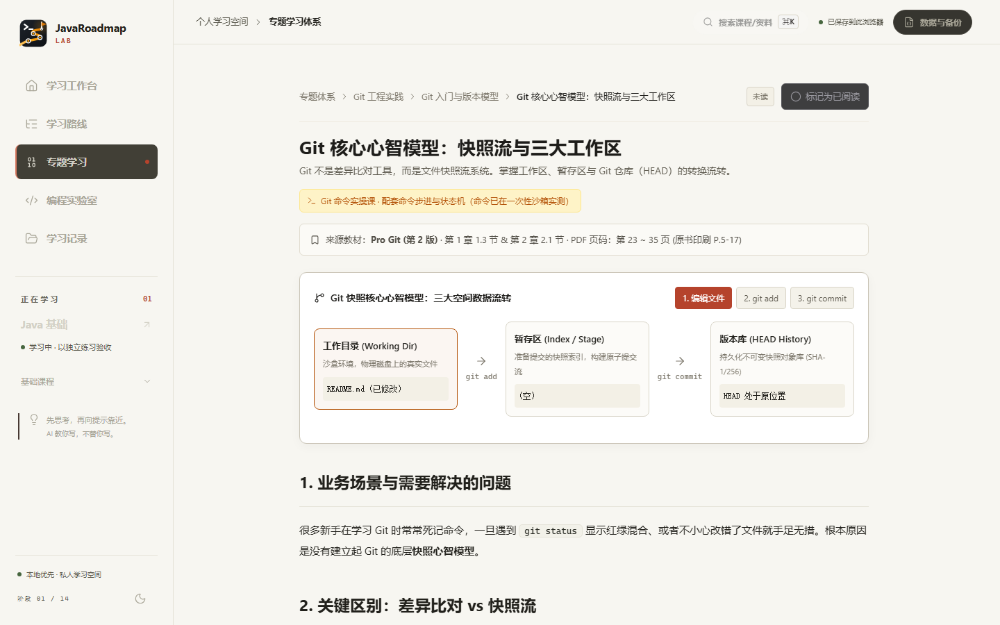

# JavaRoadmap Lab

**面向独立编程能力培养的 Java 后端与 AI 应用开发学习平台。**

JavaRoadmap Lab 把一条 14 Stage 的学习路线做成了可以动手验证的学习系统：仓库维护课程教程、Java 源码与练习资产；[JavaRoadmap Lab 网站](https://hrry1n.github.io/Java-AI-Learning-Roadmap/)提供课程阅读、输出预测、独立编程与学习复盘；本地 JDK 负责真实编译运行。三者围绕同一个原则——**看懂教程不等于会写代码，运行参考实现也不等于掌握**。

[在线学习网站](https://hrry1n.github.io/Java-AI-Learning-Roadmap/) · [快速开始](#快速开始) · [学习工作流](#学习工作流) · [文档索引](#路线图与相关文档)

---

## 项目介绍

- **它是什么**：一个本地优先的学习平台，由三部分组成——仓库中的课程资产（教程、概念深化课、练习、参考实现）、可交互的学习网站（JavaRoadmap Lab）、以及一组本地验证 CLI（编译、运行、比对、生成实测记录）。
- **它解决什么问题**：自学编程最常见的失败方式是"教程看懂了，代码写不出来"。这里每个概念都要求先预测输出、再修改条件、再在 TODO 骨架上独立实现核心逻辑，最后用真实 JDK 编译运行验证——把"以为自己会"变成可检验的状态。
- **为什么强调独立编程**：课程辅导只提供 L1–L4 分级提示，不直接给答案；完整参考实现需要明确确认后才加载，查看行为会计入学习记录；预测题必须先写下自己的判断再核对。网站不自动修改学习状态，也不把 AI 生成代码或参考运行算作个人完成。
- **技术主线**：以 **Java 后端**为主线（OOP → Java Core → MySQL → Spring Boot / MyBatis → Redis → 项目 A 传统后端系统），**Python / LLM / RAG / Agent** 作为第二技术栈在后续 Stage 展开（项目 B：Java 智能知识库平台）。
- **适用人群**：正在自学 Java 后端、希望用可验证方式建立独立编程能力的学习者；仓库维护者本人按此路线执行，也欢迎按同样方式参考或 fork 使用。

## 项目预览

学习工作台首页——从当前任务进入课程、预测与练习：



| 算法专题阅读 | Git 专题阅读 |
| --- | --- |
|  |  |

截图来自 V1.4 专题体系验收记录，当前内容以网站为准（[更多截图](docs/javaroadmap_lab/v1.4_screenshots/)）。

## 主要功能

| 功能 | 说明 |
| --- | --- |
| 14 Stage 学习路线 | 完整知识地图驱动站点导航，路线信息与已有材料同时呈现 |
| 主线课程阅读 | 45 节正式课程（Stage 01×13 + Stage 02×14 + Stage 03×18），支持单文件与多文件 Java 示例展示 |
| 专题学习体系 (V1.4) | 与 Java 主线并行的计算机学科专题：《Hello 算法》（29 门课，覆盖复杂度、线性结构、哈希表、树堆图与算法策略，V1.7 补齐双端队列、BST/平衡树、建堆 Top-K、二分边界、选择/堆/非比较排序、子集和、背包与编辑距离，含原创 Java 源码与交互组件）与《Pro Git》（19 门课，覆盖三大空间、分支合并、冲突撤销、忽略规则、交互式暂存与变基、worktree、子模块、钩子与历史考古，含临时沙箱实操） |
| 原著延伸阅读 (V1.4) | 主线课程嵌入《On Java 8》45 条课程关联（覆盖全部已发布课程，含代码校验断言；关联数量不等于全书逐章覆盖），辨析设计取舍并标明 Java 10 var、Java 14 Switch、Java 16 Record 等现代演进 |
| 全局穿梭搜索 (V1.4) | 快捷键 `⌘K` / `Ctrl+K` 调出 Command Palette，支持主线、算法、Git、编程题与教材索引实时模糊检索与直达 |
| 输出预测 | 12 道预测题按确定答案本地判定，先写判断再核对语义 |
| 条件修改 | 6 道开放修改题，在自己的副本上改条件、预测差异、运行验证 |
| 编程实验室 | 5 道独立编程题，Monaco 编辑器、L1–L4 渐进提示与用例边界 |
| 本地 Java 验证 | 通过 `verify-practice` 脚本比对输出，生成防伪实测指纹并导入网站 |
| 学习复盘 | 区分阅读、尝试、提示与实测证据，展示真实能力基线 |
| 本地优先与隐私安全 | 数据存当前浏览器 IndexedDB，支持带校验的完整 JSON 备份导入、合并与导出 |

## 快速开始

### 方式 A：直接在线使用（推荐首访）

访问 [hrry1n.github.io/Java-AI-Learning-Roadmap](https://hrry1n.github.io/Java-AI-Learning-Roadmap/)。支持桌面端与移动端浏览器（Safari / Chrome / Edge / Firefox），无需注册登录；学习数据保存在当前浏览器本地。

### 方式 B：本地运行网站

环境要求：**Node.js 22.12 或更新版本**（npm 按锁文件安装，无需任何模型密钥或账号）；本地运行自己的 Java 另需完整 JDK。

```bash
git clone https://github.com/HrrY1n/Java-AI-Learning-Roadmap.git
cd Java-AI-Learning-Roadmap/web
npm ci
npm run dev
```

浏览器打开 [http://127.0.0.1:5173](http://127.0.0.1:5173)。开发服务仅监听本机；端口占用会明确失败，可改用 `npm run dev -- --port 5174`（换端口会更换浏览器存储来源，先导出学习备份）。更多本地使用细节见 [web/README.md](web/README.md)。

## Java 每日课程目录怎么读

每天的课程目录是包含 `com/` 的源码根目录，内部路径与 `package` 对应。以 Stage 02 第一天为例：

```text
day01_class_object/
└─ com/javaroadmap/stage02/day01classobject/
   ├─ App.java
   └─ Student.java
```

同一天相互依赖的类放在同一个包中并一起编译；不同课程使用不同包名。IntelliJ IDEA 中将包含 `com/` 的课程目录设为 Sources Root；命令行编译与运行示例见 [环境搭建](docs/环境搭建.md)。

## 学习工作流

```text
阅读概念 → 预测输出 → 修改代码 → 独立练习 → 本地 JDK 验证 → 学习复盘
```

1. **阅读概念**：课程页从真实开发场景进入，先建立心智模型再看最小代码；多文件课程按包结构展示全部依赖类。
2. **预测输出**：对每段示例先写下自己的预期，网站按确定答案判定，不一致时回去重走执行顺序。
3. **修改代码**：条件修改题要求在自己复制的源码上改动并预测差异，不提供自动判分。
4. **独立练习**：实验室练习只有 TODO 骨架与用例契约；卡住时逐级打开 L1–L4 提示，解锁不把答案填进编辑器。
5. **本地 JDK 验证**：下载源码或使用 `verify-practice` CLI，在本机编译运行并精确比对输出，生成实测记录后导入网站。
6. **学习复盘**：复盘页分层呈现阅读、尝试、提示、参考查看与实测结果，供回顾与复习。

**诚实性约定**：AI 生成代码、运行或改进参考实现，都不等于学习者已经掌握；学习状态只由 [真实学习进度](真实学习进度.md) 中的证据决定，网站操作不会自动修改它。

## 技术栈与项目结构

| 技术 | 用途 |
| --- | --- |
| React 19 + TypeScript | 站点前端（严格模式类型检查） |
| Vite | 开发与生产构建，`base: './'` 支持任意静态子路径部署 |
| Monaco Editor | 桌面端 Java 代码编辑器（语法高亮，无语言服务器 / 编译器） |
| react-markdown + highlight.js | 课程 Markdown 与代码渲染 |
| IndexedDB | 学习记录、草稿与主题的本地存储（schemaVersion 校验的备份格式） |
| GitHub Actions | 三平台 CI 矩阵 + Pages 构建、部署与线上冒烟 |

```text
web/               # JavaRoadmap Lab 网站（React + Vite，本目录独立构建部署）
web/content/       # 课程与专题结构化元数据（构建期生成 catalog，不提交生成物）
stages/            # 课程教程、概念深化课、练习与参考实现（Java 源码唯一来源）
stages/topics/     # 算法专题等独立模块的 Java 规范源码
scripts/           # Java 课程回归、练习验证 CLI、内容与链接检查
docs/              # 环境搭建、跨平台排查、教学协作与 Lab 交付文档
学习执行计划.md     # 唯一回答"现在该学什么"的入口（CURRENT / NEXT / PARALLEL / LATER）
真实学习进度.md     # 个人学习状态，只按证据记录
统一学习路线.md     # 14 Stage 完整知识地图
```

课程内容的唯一来源是仓库里的 Markdown 与 Java 源文件；网站课程数据在构建期从这些源文件生成，不手工维护第二份副本。

## 开发、构建与测试

以下命令在 `web/` 目录运行：

| 命令 | 作用 |
| --- | --- |
| `npm run dev` | 生成课程数据并启动本地开发服务（127.0.0.1:5173） |
| `npm run typecheck` | 生成课程数据并执行严格 TypeScript 检查 |
| `npm test` | 单元测试 + 内容架构 / 练习编译 / 预测 JVM 语义等 Node 测试 |
| `npm run test:e2e` | Playwright 浏览器测试（首次需 `npx playwright install chromium`） |
| `npm run build` | 类型检查 + 生产构建，输出 `dist/` |
| `npm run check:build` | 校验构建产物的入口资源、Monaco worker 与懒加载参考文件 |
| `npm run preview` | 本地生产预览（127.0.0.1:4173，请通过 HTTP 访问而非双击 index.html） |

以下命令在仓库根运行：

| 命令 | 作用 |
| --- | --- |
| `bash scripts/verify_java.sh` 或 `powershell -ExecutionPolicy Bypass -File scripts\verify_java.ps1` | Java 课程回归：按 `scripts/verify_manifest.tsv` 逐课编译、运行并校验输出（当前 67 项） |
| `npm run verify:practice -- --exercise <id> --source <源码文件> --expect-file <预期输出文件>`（在 `web/`） | 学习者练习的单次精确验证；先运行 `npm run content`，替换占位符并按 [指南](docs/javaroadmap_lab/local-java.md) 生成、导入证据 |
| `python scripts/check_links.py` | 检查仓库 Markdown 相对链接 |

网站 CI 在 Ubuntu / Windows / macOS（Node 24 + Temurin JDK 25）上运行类型检查、测试、生产构建与核心浏览器测试；Java 课程回归在 Windows / macOS × JDK 21 / 25 上运行。push 到 main 后由独立 Pages 工作流构建、部署并执行线上冒烟。完整配置见 [.github/workflows/](.github/workflows/)。

## 数据与隐私

- 个人学习记录（草稿、预测、提示、实测记录、主题）只存储在**当前浏览器当前站点来源**的 IndexedDB 中。
- 不随 Git 提交同步，不自动同步 GitHub，也不会跨浏览器或跨设备自动同步。
- 定期使用顶栏"数据与备份 → 导出完整备份"导出 JSON 备份；在另一台设备导入时可选"合并"（保留同项较新版本）或"替换"（替换前会自动下载当前记录备份）。损坏或版本不兼容的备份会被拒绝导入。
- 清理站点数据、退出隐私模式或更换端口都可能使当前记录不可见，重要节点请先备份。
- 个人 Java 练习只应在本机可信 JDK 环境中运行；验证 CLI 在本地以用户权限执行，不作为任何线上服务的执行接口。

数据模型与迁移细则见 [docs/javaroadmap_lab/data-and-services.md](docs/javaroadmap_lab/data-and-services.md)。

## 路线图与相关文档

- 整体路线与当前任务：[统一学习路线](统一学习路线.md) · [学习执行计划](学习执行计划.md) · [真实学习进度](真实学习进度.md) · [求职能力矩阵](求职能力矩阵.md)
- 课程入口：[Stage 01 Java 基础](stages/stage01_java_basics/README.md) · [Stage 02 面向对象基础](stages/stage02_java_oop/README.md) · [课程总览](stages/README.md)
- 环境与运行：[环境搭建](docs/环境搭建.md) · [Java 课程运行说明](docs/Java课程运行说明.md) · [跨平台问题排查](docs/跨平台问题排查.md) · [验证脚本](scripts/README.md)
- 教学与协作：[教学协作细则](docs/教学协作细则.md) · [AGENTS.md](AGENTS.md)
- Lab 网站文档：[Lab 交付文档目录](docs/javaroadmap_lab/README.md) · [本地 Java 验证指南](docs/javaroadmap_lab/local-java.md) · [内容架构与脚手架指南](docs/javaroadmap_lab/new-lesson-guide.md) · [数据模型与迁移细则](docs/javaroadmap_lab/data-and-services.md) · [V1.4 设计选型与去重报告](docs/javaroadmap_lab/v1.4_design_proposals.md) · [web/README.md](web/README.md)

下一批课程建设方向：Stage 02 第二批（继承与多态深化、逐日示例与综合练习，含 S02A4 / S02B1 / S02B3 转正）。路线层的长期取舍见 [统一学习路线](统一学习路线.md) 与 [学习执行计划](学习执行计划.md)。
