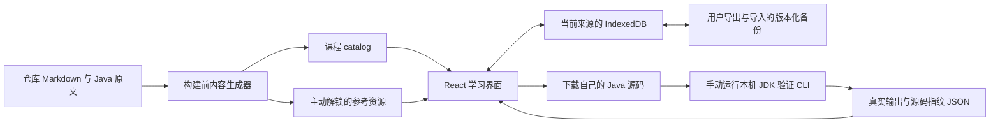

# 工程架构

首版是 React + TypeScript strict + Vite 静态应用，没有站点服务端。课程构建和本机 JDK 验证使用 Node 标准库；网站读取内容快照，在浏览器保存个人记录，不调用外部模型或执行 API。参考源码在主动解锁时请求同源静态资源。

## 数据流与边界

生成器只读原资产，网站不写仓库文件。CLI 复制用户明确指定的独立源码副本到临时目录运行，不读取 `answers/` 或 `my_practices/`；它不是网站后端，也不监听端口。课程参考回归与用户自测是两条不同验证路径。

## 目录与责任

| 路径 | 责任 |
| --- | --- |
| `web/src/App.tsx` | 工作台、路线、课程、预测/修改、实验室、复盘与主要状态协调 |
| `web/src/catalog.ts` | 课程数据入口及源路径到页面的导航 |
| `web/src/content-types.ts` | 课程、练习、案例、预测、Stage 与来源文档契约 |
| `web/src/components/` | Markdown、代码显示、对话框、桌面与轻量编辑器 |
| `web/src/lib/learning-store.ts` | IndexedDB、数据校验、备份合并、实测记录关联 |
| `web/src/lib/services.ts` | 预测判定、源码 SHA-256、课程导师、执行器与真实模型接口 |
| `web/scripts/generate-content.mjs` | 原资产读取、少量教学桥元数据、关联检查与构建数据 |
| `web/scripts/verify-practice.mjs` | 手动本地 JDK 编译、执行、断言与证据生成 |
| `web/src/**/*.test.ts` | 数据与服务的单元测试 |
| `web/scripts/*.test.mjs` | 内容和本地验证工具的 Node 测试 |
| `web/e2e/` | 实际页面流程、响应式与无障碍自动化 |

导航使用 `#/...`，避免静态托管为每个课程配置路由回退。没有引入额外路由或全局状态依赖；页面共享单个版本化学习快照。入口失败、无效链接与未找到内容应给出可返回课程的界面。

## 内容只维护一次

`npm run content` 读取 day01–day06 的 Java、7篇深化课 README、预测与修改、结构化练习、当前计划、14 Stage 路线和真实状态。生成器只为已有基础示例补教学动作与关联，不复制维护原正文。稳定 ID 用于持久化，避免中文标题变化导致草稿丢失。

完整参考实现位于独立静态 JSON，默认 catalog 只有来源与资源映射。用户主动确认后才加载，查看行为独立记录；不会填入练习编辑器。预测标准答案存在本地数据中用于确定性判断，这不是需要答案保密的考试系统。原文差异按题旁注说明，不静默改题或擅改课程。具体统计和源审计见[课程接入](content.md)。

构建输出包含当时的内容快照。`src/generated/` 与 `public/reference/` 是忽略的生成产物，不能在这里维护课程，也不提交 Git；每次新检出、开发、测试和构建都先生成。

## 本地学习状态

IndexedDB 的单个 `learning/snapshot` 保存 `schemaVersion: 1`。状态包括主题、最后课程、阅读位置、草稿、提示等级、预测回答、复盘、实测记录与参考查看。阅读与页面停留不转换成掌握状态；网站没有替学习者勾选阶段验收的接口。

输入先更新页面，再以短防抖保存；保存排队并等待事务完成后才显示成功。独立 revision 检测其他标签页写入，遇到冲突或存储错误拒绝覆盖，提示导出当前内容。读取到损坏快照不自动清空它。

备份为受校验的 JSON。导入先预览，再明确确认合并或替换；合并按条目更新时间处理，提示保留最高等级，实测按 ID 去重并拒绝同 ID 异内容。替换前触发当前备份下载。首版只兼容已知 v1，未来格式拒绝导入并要求保留原文件。详细字段和限制见[数据与服务边界](data-and-services.md)。

浏览器按来源隔离数据，所以 `localhost`、`127.0.0.1`、不同端口、浏览器与设备不会自动共享。Windows/macOS 迁移通过备份完成。没有后台同步、账号或服务器数据库；未来云同步可在现有版本化快照与合并契约之外增加同步传输层，但尚未实现。

## 编辑与 Java 验证

Monaco 只在需要的编程界面加载，保留专用 worker；手机默认 textarea，可切换只读高亮预览。专业编辑器加载失败时提供轻量输入，不让草稿编辑依赖大型编辑器成功加载。Java basic language 提供词法高亮，不提供 Java 语言服务器、语义诊断或编译能力。

`JavaExecutor` 契约接收练习、源码、标准输入与取消信号，返回实际 stdout/stderr、退出码和源码指纹。当前 `localExecutor.available` 为 false，明确引导用户下载源码运行本机 JDK。页面没有可伪造成功的“在线运行”路径。

手动 CLI 要求用户在运行前提供输入与预期文件，以 UTF-8 编译并运行，采集真实结果、JDK 与命令。输出 JSON 通过源码 SHA-256 和练习 ID 绑定当前草稿；源码变化后旧记录保留但标明版本不同。它只验证列出的输入和断言，不能自动证明作者、独立性、整题完成或 Stage 掌握；JSON 没有签名认证。

本机超时和输出上限只用于常见错误，不隔离文件、网络或进程权限。云端自动执行必须另接隔离沙箱，不能把 CLI 暴露成公开接口。跨平台命令和证据流程见[本地运行指南](local-java.md)。

## 导师与外部服务

`courseTutor` 按仓库[教学协作细则](../教学协作细则.md)提供四级课程提示、五步 Debug 动作和 P0–P4 Review 清单；反馈是固定课程内容，不自动分析错误，也不自动生成代码。提示逐级主动展开，使用等级进入复盘。

`ModelTutorService` 为真实模型定义独立异步接口，包含模式、级别、上下文与取消信号。当前实现明确不可用，没有虚构 AI 会话，也没有让学习者填写前端密钥的入口。真实模型与 Java 沙箱的供应商实现均尚未接入。

将来接入时需要受控服务端承担认证、限流、费用预算、超时取消、输出校验与敏感日志处理；密钥不能进入源码、前端环境变量或学习备份。源码与问题发送到外部服务前需明确启用该能力。首版不为未配置服务创建假的成功状态。

## 构建、测试与部署

`npm run typecheck` 先生成课程，再执行严格 TypeScript 检查；`npm test` 运行 Vitest 与 Node 测试；`npm run test:e2e` 使用 Playwright 检查实际浏览器路径。内容测试核对资产数量、原文一致性、关联与答案隔离，数据测试验证保存、恢复、损坏与冲突边界。浏览器检查和真实 JDK 运行的结果独立记录，不用模拟测试代替环境证据。

`npm run build` 产出静态 `dist/`；Vite 的相对 base 与 hash 路由支持根目录或子目录托管。部署只需要构建产物，不需要 Java、模型 Key 或应用服务器。静态页面不会执行未知 Java。更新课程或应用后重新构建，用户数据仍在各自浏览器来源中；切换域名或端口前先备份。

依赖、生成目录、构建、测试缓存、环境文件、备份与证据均由 `web/.gitignore` 排除。实际验证的平台、截图、性能与未验证项见[验收记录](validation.md)，不从工具名称推断已经符合全部浏览器或 WCAG 要求。
